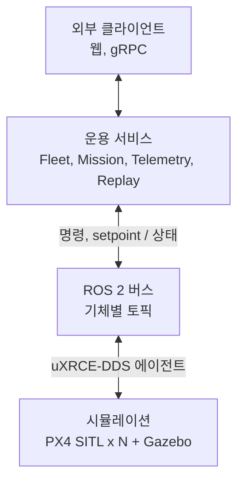
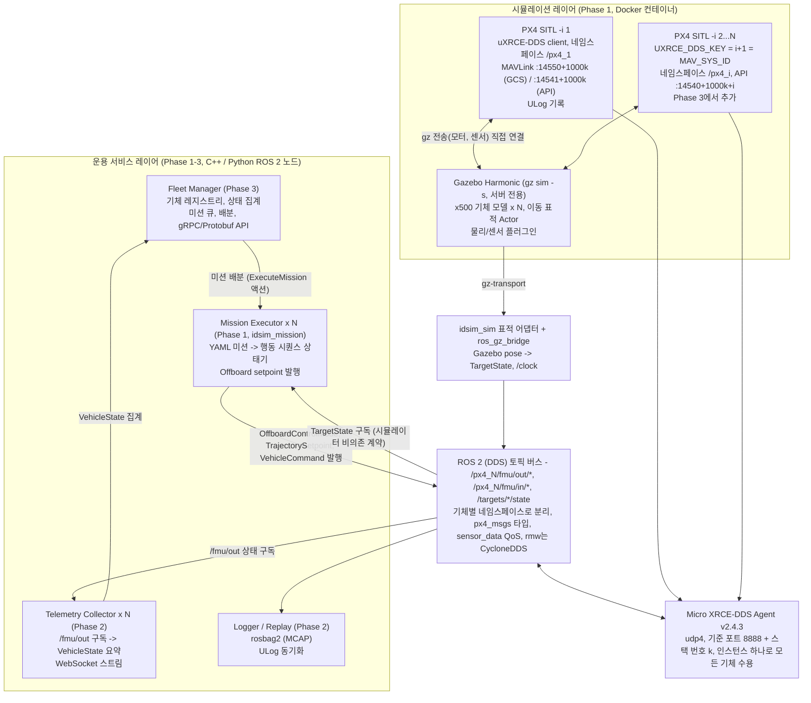
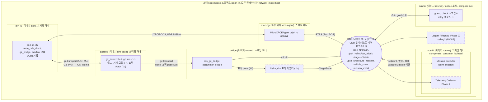
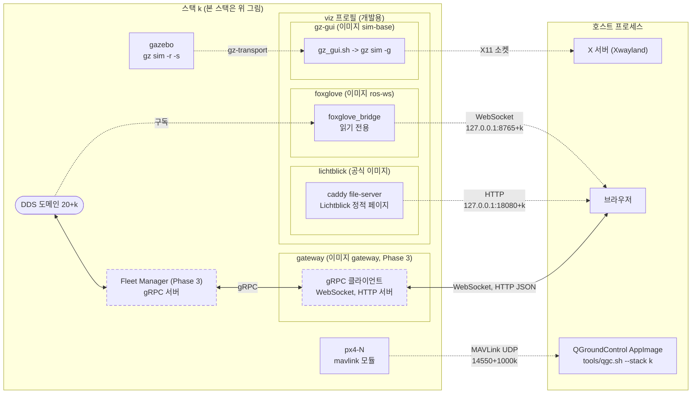
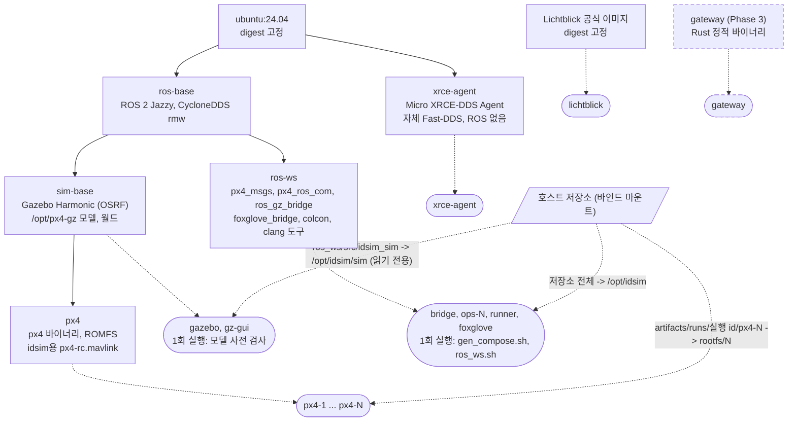

# idsim 아키텍처

이 문서는 idsim(Interceptor Drone Simulator)의 목표, 레이어 구조, 기술 스택, 실행 환경, 테스트 전략을 정의한다.

## 목표와 범위

이 프로젝트는 드론 자율비행 플랫폼 팀의 핵심 업무인 "자율비행 플랫폼 아키텍처, 비행제어-자율비행 알고리즘 간 데이터 파이프라인, Fleet Management, Mission Planning, Telemetry, 로그/리플레이, 테스트 자동화"를 PC 한 대 위의 시뮬레이션 환경으로 재현한다. 실제 기체 없이도 PX4 SITL + Gazebo로 비행 시험 검증 체계를 돌려 보는 것이 목적이다. 프로젝트명 idsim은 Interceptor Drone Simulator의 약자로, 이동하는 표적(공격 드론 등)을 방어적 수단으로 요격하는 드론 플릿을 올릴 플랫폼을 시뮬레이션한다는 뜻이다.

| 플랫폼 업무 항목 | 이 프로젝트에서의 대응 과제 | Phase (roadmap.md) |
| --- | --- | --- |
| 비행제어-자율비행 알고리즘 간 데이터 파이프라인, 통신 표준화 | PX4 <-> ROS 2(uXRCE-DDS) 브리지, 토픽/QoS/좌표계 규약 정의 | 1a |
| 하드웨어-소프트웨어 인터페이스 정의 | SITL 기체를 "하드웨어"로 간주한 인터페이스 계약(토픽, 서비스, MAVLink 포트) 문서화 | 1a |
| Mission Planning | 미션 정의(waypoint/행동 시퀀스) -> ROS 2 미션 노드 -> PX4 Offboard 제어 | 1b, 3 |
| Telemetry | PX4 uORB 토픽을 수집해 요약 상태로 재발행하는 수집기 서비스 | 2 |
| 대규모 로깅/리플레이 시스템 | rosbag2(MCAP) 기반 기록 + 리플레이 + ULog 연동 | 2 |
| Fleet Management | 다중 PX4 인스턴스 스폰, 기체별 네임스페이스, 상태 집계 API(gRPC/Protobuf) | 3 |
| CI/CD, 테스트 자동화 | Docker Compose 환경 + headless SITL 통합 테스트(pytest/GoogleTest) + GitHub Actions | 1a부터 전체 |
| 실시간 영상 스트리밍 | Gazebo 카메라 -> GStreamer -> WebRTC. 이번 범위 밖, 확장 단계로 미룸 | 확장 |

다루지 않는 것: 특정 표적을 추적, 교전하는 유도 알고리즘 자체. 움직이는 표적은 Gazebo 안의 임의 이동 엔티티로 두고, 그 위치를 미션 노드가 "추적 대상 좌표"로 구독하는 수준까지만 다룬다. 즉 교전 로직이 아니라 그 로직을 올릴 플랫폼(통신, 미션, 텔레메트리, 리플레이, 테스트)을 만든다.

## 전체 아키텍처

세 레이어로 나눈다. 아래의 시뮬레이션 레이어(PX4 SITL x N + Gazebo)는 실제 기체를 대신하고, 가운데 ROS 2 버스가 "비행제어-자율비행 알고리즘 간 데이터 파이프라인"이며, 위의 운용 서비스 레이어가 Fleet, Mission, Telemetry, Replay다. 운용 서비스는 시뮬레이터를 전혀 모르도록 설계해, 나중에 PX4 SITL 컨테이너를 실기체로 바꿔도 그대로 동작하게 한다.

큰 그림은 다음과 같다.



- 운용 서비스는 ROS 2 버스만 보고, 아래가 시뮬레이터인지 실기체인지 모른다.
- 시뮬레이션 레이어는 실기체로 바꿀 수 있는 자리다. 기체 하나가 PX4 하나다.
- 외부 클라이언트는 ROS 2를 모르고 Fleet Manager의 API로만 플릿을 본다.

이 원칙은 표적 경로에도 적용한다. Mission Executor는 Gazebo 토픽을 직접 구독하지 않고 `idsim_interfaces`의 `TargetState` 계약(`/targets/<id>/state`)만 구독한다. 시뮬레이션에서는 `idsim_sim`의 표적 어댑터 노드가 ros_gz_bridge로 받은 Gazebo pose를 이 계약으로 변환해 발행하고, 실기체에서는 같은 토픽을 추적기가 채운다.

세부 구성은 다음과 같다.



위쪽 서비스는 ROS 2 토픽만 보고 동작하고, 아래쪽 PX4는 uXRCE-DDS 에이전트 하나를 통해 모든 인스턴스가 같은 DDS 도메인에 올라온다. 기체를 실제로 움직이는 setpoint는 기체별 Mission Executor만 발행하고, Fleet Manager는 미션을 배분하고 상태를 집계할 뿐 `/fmu/in/*`에 직접 쓰지 않는다. MAVLink는 QGroundControl 확인용 곁가지이며 운용 서비스는 사용하지 않는다. PX4 <-> Gazebo 사이의 모터, 센서 교환은 ROS 2를 거치지 않는 직접 연결이다.

## 기체 식별과 설정의 단일 출처

기체 한 대는 compose 서비스 이름, PX4 인스턴스 번호, `MAV_SYS_ID`와 `UXRCE_DDS_KEY`, ROS 네임스페이스, Gazebo 모델 이름, MAVLink API 포트라는 여러 식별자를 동시에 가진다. 이것을 손으로 맞추지 않고 `config/fleet.yaml` 하나에서 파생한다.

- 기체 번호 N은 1부터 시작한다. 단일 기체 Phase에서도 N=1이며, PX4 인스턴스 0의 "네임스페이스 없음" 특수 케이스는 어디서도 쓰지 않는다. `PX4_UXRCE_DDS_NS=px4_N`으로 네임스페이스를 항상 명시한다.
- 파생 규칙: PX4 인스턴스 = N, `MAV_SYS_ID` = `UXRCE_DDS_KEY` = N+1, 네임스페이스 = `/px4_N`, Gazebo 모델 이름 = `<모델>_N`(모델은 airframe의 시뮬레이터 모델 이름에서 `gz_`를 뗀 것. 1a는 `x500_N`), MAVLink API 포트 = 14540 + 1000k + N(k는 스택 번호), compose 서비스 = `px4-N`.
- `config/fleet.yaml`에는 사람이 고르는 값만 적는다: 기체 목록(번호 `id`, `airframe`, 초기 `pose` {x, y, z, yaw}(Gazebo 월드 좌표 ENU, m, rad), 기체별 SITL 파라미터 `px4_params`), 월드(`world.name`, `world.file`, 원점 `world.origin` {lat, lon, alt}, `world.speed_factor`), 표적 목록 `targets`, 공통 SITL 파라미터 파일 `px4.params_file`, 기동 방식 `px4.start`(parallel 또는 sequential). `airframe`(예: `4001_gz_x500`) 하나에서 `SYS_AUTOSTART`, `PX4_SIM_MODEL`, Gazebo 모델 이름이 파생된다. 파생값(포트, 네임스페이스, `MAV_SYS_ID`, `UXRCE_DDS_KEY`, 모델 이름, 서비스 이름)은 적을 수 없고 생성 스크립트가 거부한다. `px4_params`에서도 식별 파라미터(`MAV_SYS_ID`, `UXRCE_DDS_KEY`, `UXRCE_DDS_DOM_ID`, `UXRCE_DDS_AG_IP`, `SYS_AUTOSTART`)는 거부한다. 1a에서는 `targets`가 비어 있어야 하고 `world.speed_factor`는 null이어야 한다(배속 기제는 Phase 3에서 정한다). 기체 번호는 1-9, 기체 간격은 2 m 미만이면 거부하고 4 m 미만이면 경고한다. 스택 번호 k(0-9)는 추적 파일에 두지 않고 생성 인자(`--stack`, 없으면 `IDSIM_STACK_INDEX`, 없으면 0)로 준다. `GZ_PARTITION`은 gz-transport 디스커버리를 스택 단위로 격리한다.
- 생성 스크립트 `tools/gen_compose.py`가 이 파일에서 compose 파일과 `stack.json`을 `artifacts/runs/<실행 id>/`에 만든다. `stack.json`은 실행 시점의 단일 출처이며, 스크립트와 테스트 fixture는 식별자를 다시 계산하지 않고 이 파일만 읽는다(경로는 `IDSIM_STACK_FILE`). launch 파일은 생성하지 않고 노드 파라미터 파일 `params/ops-N.yaml`만 생성한다. 그 안에는 `/**` 아래 `use_sim_time: true`와 식별값 `vehicle.id`, `vehicle.ns`, `vehicle.sysid`만 있고, timeout과 주기 같은 튜닝 값은 노드 선언 기본값에 둔다. `stack.json`의 기체 항목은 `vehicle_id`, `params_file`, `executor_node`(Executor의 노드 FQN. healthcheck와 진단용)를 싣고, `services.ops`와 `startup.node_stages`가 운용 노드 서비스와 기동 단계를 적는다. 생성 스크립트는 `ros-ws` 컨테이너 안에서 실행하고(PyYAML을 호스트에 요구하지 않는다) 호스트 진입점은 `tools/gen_compose.sh`, 생성과 compose 호출을 묶은 편의 스크립트는 `tools/sim_stack.sh`다. Phase 1에서 기체 1대짜리로 시작하고 Phase 3에서 같은 스크립트로 3대를 만든다.
- 노드는 네임스페이스와 sysid를 params(`stack.json`에서 생성)로 받고, 수신한 `vehicle_status`의 `system_id`, `component_id`와 대조한다. 위 파생 규칙(N+1 등)을 노드 코드에서 다시 계산하지 않는다. 빈 네임스페이스와 `target_system` 0은 `idsim_common`의 타입이 만들지 못하게 막는다. 대조가 어긋나면 오류이고, `vehicle_status`를 아직 받지 못한 동안은 명령만 보류한다. Executor에서 이 게이트는 goal의 준비 단계(PREPARING)에 있고, 발행을 시작하기 전의 불일치는 NOT_READY, 시작한 뒤의 불일치는 REASON_INTERNAL로 끝난다. 노드는 configure 때 `vehicle.*` 누락이나 서로 맞지 않는 값, `use_sim_time` false를 거부한다.
- 계약 메시지에 실리는 기체 식별자 `vehicle_id`는 기체 네임스페이스에서 앞의 "/"를 뗀 문자열이다(`px4_N`). 생성 스크립트가 `stack.json`의 기체 항목과 노드 params(`vehicle.id`)에 직접 싣고, 노드와 테스트는 계산하지 않고 읽는다. `idsim_common`의 함수는 변환이 아니라 대조를 한다(노드의 네임스페이스가 "/" + `vehicle_id`인지, 토큰이 하나인지). 소비자는 `vehicle_id`의 내용을 해석하지 않는다(N을 뽑거나 sysid를 계산하지 않는다).
- `world.origin`은 1a에서는 선택 항목이고(원점을 읽는 노드가 없다) 1b부터 필수이며 원점의 유일한 출처다. 1b부터는 커스텀 월드에서도 gazebo wrapper가 항상 이 값을 적용하고, 운용 노드와 표적 어댑터는 같은 값을 params(`stack.json`에서 생성)로 받는다. 원점은 메시지에 싣지 않는다. 기체의 스폰 pose는 운용 노드에 주지 않고 통합 테스트의 교차 검증에만 쓴다(Gazebo에만 있는 지식이다).

## 기술 스택 선정 근거

x86_64 Linux 호스트 위에서 Ubuntu 24.04 + ROS 2 Jazzy + PX4 정식 릴리스 태그(v1.17.0) + Gazebo Harmonic + uXRCE-DDS 조합을 표준으로 잡는다. PX4 공식 문서의 예제는 아직 Humble + 22.04 기준이지만, [px4_msgs](https://index.ros.org/p/px4_msgs/) CI가 Jazzy를 함께 빌드하고 Jazzy의 기본 Gazebo가 Harmonic이라 조합이 자연스럽다. v1.16 알파 시절 Jazzy + 24.04에서 gz_bridge 클럭 타임아웃 보고([PX4 #24159](https://github.com/PX4/PX4-Autopilot/issues/24159))가 있었으므로 PX4는 알파, main 대신 릴리스 태그로 고정하고, Phase 1 첫 단계를 이 조합의 스모크 테스트로 잡는다.

| 구성 요소 | 선택 | 이유, 대안 |
| --- | --- | --- |
| 호스트 / OS / ROS 2 | x86_64 Linux 호스트, Ubuntu 24.04, ROS 2 Jazzy | [PX4 ROS 2 가이드](https://docs.px4.io/main/en/ros2/user_guide) 예제는 Humble 기준이라 명령어를 따를 때 humble -> jazzy 치환. Jazzy는 LTS 2029년까지(Humble은 2027). px4_msgs는 Humble, Jazzy 모두 CI 빌드. 컨테이너 안에서 돌리므로 호스트 배포판은 무관하나 아키텍처는 x86_64로 고정 |
| ROS 2 미들웨어 | CycloneDDS (`rmw_cyclonedds_cpp`), 모든 ROS 2 컨테이너에 `RMW_IMPLEMENTATION`으로 고정 | Jazzy 기본 FastDDS는 같은 호스트로 판단되는 참가자끼리 공유 메모리 전송을 시도해, 컨테이너마다 `/dev/shm`이 다르면 "토픽은 보이는데 데이터가 안 온다"가 된다. CycloneDDS는 기본이 UDP 전용이라 이 함정이 없고, 설정 파일 하나로 피어와 멀티캐스트를 제어하기 쉽다. uXRCE-DDS Agent는 내부적으로 FastDDS를 쓰지만 표준 RTPS로 CycloneDDS 노드와 통신한다. 단 에이전트는 호스트 인터페이스 주소만 광고하므로 Cyclone 쪽에서 인터페이스를 lo로 고정하면 에이전트를 찾지 못한다(실측). `config/cyclonedds.xml`은 인터페이스를 고정하지 않고 유니캐스트 피어 127.0.0.1과 멀티캐스트 끔만 둔다 |
| 비행제어 | PX4 SITL, 정식 릴리스 태그 고정 (v1.17.0) | uXRCE-DDS는 v1.14부터 지원. px4_msgs는 펌웨어와 같은 release/1.17 브랜치의 커밋 SHA로 고정. v1.17.0은 메시지 버저닝 범위가 가장 넓어 토픽 매핑 설계를 가장 세게 시험한다. 태그를 올릴 때는 스모크 golden 단계 통과가 조건이다 |
| 시뮬레이터 | Gazebo Harmonic (gz sim), x500 모델 | [PX4 Gazebo 문서](https://docs.px4.io/main/en/sim_gazebo_gz/) 기본값. `gz sim -s`(서버 전용)로 GUI 없이 실행 가능해 CI에 적합. 센서 변형(x500_depth, x500_gimbal 등)으로 확장 |
| PX4 <-> ROS 2 브리지 | uXRCE-DDS (Micro XRCE-DDS Agent v2.4.3) | PX4 uORB 토픽이 `/fmu/out/*`, `/fmu/in/*`로 직접 노출. v2.4.3은 PX4 문서의 Jazzy 권장 버전이며 v3.x는 PX4 재빌드가 필요해 쓰지 않는다. 대안 MAVROS는 MAVLink 경유라 지연과 변환이 한 겹 더 있고 PX4 쪽 기본 경로가 아님 |
| GCS 연동 | MAVLink UDP, QGroundControl(호스트 스크립트 `tools/qgc.sh`, 선택) | 개발 중 화면 확인용. compose 서비스가 아니라 호스트에서 AppImage를 직접 실행하며 버전과 sha256은 `versions.env`에 고정하고 내려받은 파일은 캐시한다. PX4 SITL은 한 스택 안의 모든 인스턴스가 GCS용으로 공통 14550 + 1000k로 보내고 온보드 API(MAVSDK)용으로 14540 + 1000k + N을 연다. 포트는 px4 이미지가 PATH 앞에 두는 idsim용 `px4-rc.mavlink`(저장소 `docker/px4/px4-rc.mavlink`)가 정하며(상류 파일은 환경변수로 바꿀 수 없다) payload와 gimbal 링크는 열지 않는다. QGroundControl은 k = 0이면 기본 설정으로 붙고 다른 k는 `tools/qgc.sh --stack k`가 QGC 설정 파일의 수신 포트를 맞춘다. `MAV_SYS_ID`가 스택 간에 같으므로 QGC 하나는 한 번에 한 스택만 본다. SITL 파라미터 `COM_RC_IN_MODE`가 4라 QGroundControl의 수동 모드와 가상 조이스틱은 쓸 수 없다. 커스텀 Fleet UI는 이번 범위 밖 |
| 토픽 시각화 | Lichtblick(Foxglove 호환 오픈소스 뷰어, MPL) + foxglove_bridge, compose `viz` 프로필 | 실시간 토픽과 MCAP 기록물을 브라우저에서 플롯과 3D로 본다. 계정 없이 로컬에서 쓸 수 있고 공식 이미지를 digest로 고정할 수 있어 공식 Foxglove 앱 대신 쓴다. foxglove_bridge 3.x는 서브프로토콜 foxglove.sdk.v1만 받고 Lichtblick은 이를 제시한다. 브리지는 읽기 전용으로 구성해 토픽 버스에 쓰지 못한다 |
| 서비스 간 API | gRPC + Protobuf | Fleet Manager의 외부 API만 gRPC로, 내부는 ROS 2 토픽/서비스/액션 |
| 로깅 | rosbag2 + MCAP 스토리지, PX4 ULog | MCAP은 단일 파일, 인덱스, 압축 지원, Lichtblick으로 바로 열림. ULog는 PX4 내부 상태의 원본 |
| 언어 | 핵심 노드 C++17 (rclcpp), 도구, 테스트, 어댑터 Python (rclpy, pytest), 브라우저 게이트웨이 Rust | Linux C++ 기반. 테스트는 GoogleTest(단위) + pytest(통합). 기록물 인덱스 CLI, 시나리오 runner, Phase 2의 임시 WebSocket 어댑터는 Python. Rust는 ROS 2에 의존하지 않는 컴포넌트에만 쓴다. 현재는 Phase 3의 브라우저 게이트웨이 하나 |
| 컨테이너 | Docker Compose, 다중 컨테이너 | Phase 별 컨테이너 추가. Kubernetes는 확장 단계 |

주의할 점 세 가지. 첫째, PX4 토픽을 구독하는 ROS 2 노드는 `rmw_qos_profile_sensor_data` 기반 QoS를 명시해야 한다(기본 QoS로는 수신 안 됨). 둘째, 좌표계는 PX4가 NED/FRD, ROS와 Gazebo가 ENU/FLU라 `TrajectorySetpoint`을 보낼 때와 표적 pose를 setpoint로 바꿀 때 모두 변환이 필요하다. 셋째, PX4 v1.16부터 메시지 버저닝이 도입되어 일부 토픽 이름에 `_v<N>` 접미사가 붙으므로, 노드는 토픽 이름을 하드코딩하지 않고 `idsim_common`의 매핑을 통해서만 얻는다. 매핑은 골든의 토픽 전부를 담은 기술자 목록 하나이고, key는 방향(/fmu/in, /fmu/out)과 논리 이름이다. px4_msgs 타입은 기술자에 묶여 호출자가 따로 고르지 않으며, 접미사는 타입의 `MESSAGE_VERSION` 상수에서 컴파일 시점에 파생한다(상수가 없거나 0이면 접미사 없음). 손으로 쓴 태그별 접미사 테이블은 두지 않는다. /fmu/in 기술자는 기본이 발행 차단이고 공개 API로 발행할 수 있는 것은 허용 목록(1a는 `offboard_control_mode`, `trajectory_setpoint`, `vehicle_command`)뿐이다. 허용 목록에 토픽을 더하려면 기술자 변경, px4-engineer의 승인, PR 본문에 적은 허용 근거, 허용 목록 기대 집합을 비교하는 단위 테스트의 갱신, `docs/interface.md`의 공개 /fmu/in 목록 갱신이 한 PR에 함께 있어야 한다. 이 차단은 실수 방지 수준이며 보안 경계가 아니다(의도적인 우회는 lint와 코드 리뷰로만 잡는다). 대신 스모크 테스트가 저장한 골든 토픽 목록(`tests/fixtures/px4/<PX4_TAG>/`)과 매핑 결과를 단위 테스트가 비교해, 태그를 올릴 때 이 테스트가 먼저 깨지게 한다. 이 문서와 로드맵에서도 접미사가 붙은 토픽 이름을 적지 않는다. 이 세 가지를 Phase 1에서 공통 라이브러리로 감싸는 것이 이후 모든 노드의 토대가 된다.

## 핵심 기술 간단 소개

이 프로젝트에 등장하는 기술을 "무엇이고, 여기서 어떤 역할인지"만 압축한다. DDS와 shared memory IPC는 이미 익숙한 영역이라 PX4 생태계 쪽 용어 위주로 정리했다.

| 기술 | 무엇인가 | 이 프로젝트에서의 역할 |
| --- | --- | --- |
| [PX4](https://docs.px4.io/main/en/) | 오픈소스 비행제어 스택(자세, 위치 제어, 상태 추정, 페일세이프, 미션 실행). 내부 모듈은 uORB라는 pub/sub 메시징으로 통신한다. 보통 Pixhawk 계열 FMU에 올리는 펌웨어 | 기체의 "두뇌". 우리 코드는 PX4를 수정하지 않고 외부에서 명령, setpoint를 주고 상태를 받는다 |
| PX4 SITL | Software-In-The-Loop. PX4 펌웨어를 하드웨어 없이 Linux 프로세스로 빌드해 실행하고, 센서 입력, 모터 출력을 시뮬레이터와 주고받는 모드. 실기체와 같은 코드 경로가 돌아간다. `-i N`으로 인스턴스를 여러 개 띄울 수 있다 | 실제 기체를 대신하는 컨테이너. 기체 한 대 = SITL 프로세스 하나 |
| [Gazebo (gz sim)](https://gazebosim.org/) | OSRF의 로봇 물리 시뮬레이터. 강체 물리, 센서(카메라, IMU, GPS, 라이다) 플러그인, SDF 모델 형식. "Gazebo Classic"(구버전, 11.x)과 새 세대 "gz"(Fortress/Garden/Harmonic)는 다른 코드베이스다 | x500 기체 모델의 물리와 센서, 이동 표적 Actor, 월드. PX4와는 gz-transport로 직접 연결 |
| [uORB](https://docs.px4.io/main/en/middleware/uorb.html) | PX4 내부의 경량 pub/sub 메시징. 토픽당 고정 구조체(`.msg`), 공유 메모리 기반 | 직접 만지지 않지만, ROS 2에서 보이는 `/fmu/out/*` 토픽이 결국 uORB 메시지다 |
| [uXRCE-DDS](https://docs.px4.io/main/en/middleware/uxrce_dds) | eProsima의 Micro XRCE-DDS(DDS for eXtremely Resource Constrained Environments) 위에 만든 PX4 <-> ROS 2 브리지. PX4 쪽 "client"가 uORB 토픽을 직렬화해 UDP/시리얼로 "agent"에 보내고, agent가 이를 진짜 DDS 토픽으로 발행한다. ROS 2 쪽에서는 일반 토픽처럼 보인다. px4_msgs 패키지가 메시지 타입을 제공 | PX4와 운용 서비스를 잇는 유일한 데이터 경로. agent 하나가 모든 SITL 인스턴스를 수용 |
| [CycloneDDS](https://cyclonedds.io/) | Eclipse의 DDS 구현. ROS 2에서는 `rmw_cyclonedds_cpp`로 쓴다. 기본 전송이 UDP이고 XML 설정으로 인터페이스, 피어, 멀티캐스트를 제어 | 모든 ROS 2 노드의 rmw. 컨테이너 간 통신을 UDP로 단순화 |
| [MAVLink](https://mavlink.io/en/) | 드론 <-> GCS 통신용 경량 메시지 프로토콜(바이너리, 최대 280바이트 패킷, XML로 메시지 정의). 텔레메트리, 명령, 미션 업로드, 파라미터 등 업계 표준. PX4, ArduPilot, QGroundControl이 모두 사용 | QGroundControl 연동(GCS 포트 UDP 14550 + 1000k, 스택 안 전 인스턴스 공통) 전용. 필요하면 MAVSDK로 온보드 API 포트(14540 + 1000k + N)에 보조 경로를 만들 수 있지만 주 경로는 uXRCE-DDS |
| Offboard 모드 | PX4 비행 모드 중 하나. 외부 컴퓨터가 위치/속도/자세 setpoint를 주기적으로 보내면 PX4가 그걸 따른다. setpoint가 `COM_OF_LOSS_T`(기본 1 s) 이상 끊기면 `COM_OBL_RC_ACT`가 정한 페일세이프 동작으로 넘어간다 | 미션 노드가 기체를 움직이는 방식. `OffboardControlMode` + `TrajectorySetpoint`를 계속 발행. `COM_OBL_RC_ACT`는 SITL 시작 파라미터로 명시해 페일세이프 동작을 결정적으로 만든다 |
| [ros_gz_bridge](https://github.com/gazebosim/ros_gz) | Gazebo의 gz-transport 토픽과 ROS 2 토픽을 양방향 변환하는 브리지 | 표적 Actor pose, `/clock`을 ROS 2로 노출. 확장 단계에서 카메라 영상도 같은 경로 |
| Gazebo Actor | 물리 연산 없이 스크립트 궤적을 따라 움직이는 애니메이션 엔티티. 시뮬레이션 시간 기준으로 결정적 | 이동 표적. 물리 비용이 없고 테스트 재현성이 좋다 |
| [rosbag2 / MCAP](https://mcap.dev/) | rosbag2는 ROS 2 토픽 기록, 재생 도구. MCAP은 Foxglove가 만든 컨테이너 포맷으로 단일 파일, 인덱스, 압축, 스키마 내장. Jazzy의 rosbag2 기본 스토리지 | 로그/리플레이의 저장 형식 |
| [ULog](https://docs.px4.io/main/en/dev_log/ulog_file_format.html) | PX4 자체 로그 포맷. uORB 토픽을 고주파로 기록. Flight Review, pyulog로 분석 | PX4 내부 상태의 원본. rosbag과 시간 정렬해 함께 보관 |
| [QGroundControl](https://qgroundcontrol.com/) | MAVLink 기반 오픈소스 GCS. 지도, 텔레메트리, 미션 편집, 파라미터 설정 | 개발 중 눈으로 확인하는 용도. `tools/qgc.sh`로 호스트에서 실행. 자동화에는 쓰지 않음 |
| [Lichtblick](https://github.com/lichtblick-suite/lichtblick) + [foxglove_bridge](https://github.com/foxglove/ros-foxglove-bridge) | Lichtblick은 Foxglove Studio에서 갈라진 오픈소스(MPL) 시각화 도구(브라우저/데스크톱). 3D, 플롯, 이미지, 지도 패널. foxglove_bridge는 ROS 2 토픽을 WebSocket으로 내보내는 ROS 패키지 | 실시간 토픽 플롯(Offboard 디버깅), 기록물 열람과 리플레이 검증. compose `viz` 프로필로만 올린다 |
| gRPC / Protobuf | Google의 스키마 기반 직렬화(Protobuf) + 그 위의 RPC 프레임워크(HTTP/2, 스트리밍 지원) | Fleet Manager의 외부 API. ROS 2 없는 클라이언트(웹, 다른 서비스)가 플릿을 조회, 명령하는 경로 |
| 브라우저 게이트웨이 (Rust) | gRPC 클라이언트(tonic)와 WebSocket/HTTP 서버(axum)를 한 바이너리에 담은 작은 서비스. ROS 2를 전혀 모른다 | 브라우저는 gRPC를 직접 못 부르므로, Fleet Manager의 두 스트림을 WebSocket으로 중계하고 미션 제출과 중단을 HTTP JSON으로 받아 gRPC로 넘긴다. 정적 페이지도 여기서 서빙 |

## 인터페이스 계약

운용 서비스와 시뮬레이션 레이어 사이의 계약은 `idsim_interfaces`와 `docs/interface.md`가 정의한다. 정의 파일(msg 10개, action 1개)은 Phase 1a에서 전부 만들고, 고정은 한 시점이 아니라 첫 소비자가 생기는 Phase의 완료에 맞춰 나눈다. 소비자 없이 고정하면 틀린 정의를 계약으로 굳히게 되기 때문이다.

| 묶음 | 고정되는 것 | 고정 시점 |
| --- | --- | --- |
| 공통 규칙 | 단위, 좌표계, 시각, NaN 금지, 이름 규칙, QoS 계약, 변경 절차 | 1a 완료 |
| 미션 실행(1a 부분) | `ExecuteMission.action`, `Mission`, `MissionItem`, `TakeoffItem`, `LoiterItem`, `YawSetpoint`의 직접 필드와 상수. TAKEOFF, LOITER, LAND 항목의 의미, 수락 정책, 취소 의미, `reason` 값의 의미(1b 부분 제외). 공중에서 끝나는 미션의 종료 동작은 뺀다 | 1a 완료 |
| 미션 실행(1b 부분) | `GoToItem`, `TrackEntityItem`의 직접 필드. GOTO, TRACK_ENTITY, RTL 항목의 의미, `REASON_TARGET_LOST`의 의미, 공중에서 끝나는 미션(마지막 항목이 LAND가 아님)의 종료 동작 | 1b 완료 |
| 표적 | `TargetState` | 1b 완료 |
| 기체 요약 | `VehicleState` | Phase 2 완료(WebSocket JSON 스키마 고정과 함께) |
| 미션 기록 | `MissionEvent` | Phase 2 완료(기록물 인덱스가 필드를 검증한 뒤) |

"고정"의 정의.

- 고정의 단위는 타입이 아니라 파일이다. 한 파일이 고정되면 그 파일의 직접 필드(이름, 타입, 순서, 기본값)와 상수(이름, 값), 그리고 `docs/interface.md`에 적힌 그 필드의 의미가 고정된다. 중첩된 타입의 내용은 그 타입의 파일이 고정될 때 고정된다.
- 중첩 타입이 바뀌면 그것을 담은 타입의 type hash(RIHS01)와 `ros2 interface show` 출력도 바뀐다. 이 전파는 상위 타입의 변경으로 보지 않는다. 전파가 허용되는 것은 그 중첩 타입이 고정되기 전까지다.
- 판정은 `idsim_interfaces`의 계약 테스트가 한다. golden은 세 종류다. type hash, 펼친 정의(`ros2 interface show` 출력. hash가 잡지 못하는 상수 값과 기본값 변경을 잡는다), 직접 정의(그 파일의 직접 필드와 상수만). 고정된 파일의 직접 정의 golden이 바뀌면 고정된 계약의 변경이고, 앞의 둘만 바뀌면 중첩 타입에서 온 전파다.
- 상수(enum 값, 비트, 이름)는 고정 전후 모두 추가만 한다. 상수의 의미는 그 상수를 처음 쓰는 소비자가 생기는 묶음과 함께 고정된다.
- 고정 전인 파일은 첫 소비자의 구현에서 드러난 문제에 한해 바꿀 수 있고, 고정 뒤에는 새 요구가 있어야 한다. 어느 쪽이든 아래 변경 절차를 따른다.
- 의미 문장 중 실측이나 소스로 확인하지 않은 경계 상황의 기체 동작은 `docs/interface.md`에 "미확인"으로 표시하고 그때 노드가 택하는 보수적 동작을 함께 적는다. 미확인 표시는 고정을 막지 않고, 관찰된 문제가 그 동작을 반증하면 위 절차로 고친다.

정의별 계약의 요지. 필드 단위의 전체 계약은 `docs/interface.md`에 둔다.

- 공통 규칙: 단위는 SI이고 스칼라 필드 이름에 단위 접미사를 붙인다. 계약 프레임은 `"world"` 하나다. 원점은 `config/fleet.yaml`의 `world.origin`이 가리키는 점(Gazebo 월드 (0, 0, 0))이고, 축은 x 동, y 북, z 위(ENU), yaw는 ENU yaw(동 0, 반시계 양, `[-pi, pi)`)다. 기체 로컬 NED와 위경도는 미션과 표적 계약에 나오지 않는다(`VehicleState`만 지도 표시용으로 WGS84를 함께 싣는다). world ENU <-> 기체 로컬 NED 변환은 `idsim_common` 한 곳에 두고(1b), PX4가 실제로 쓰는 원점(`vehicle_local_position`의 기준점)과 params로 받은 `world.origin`을 입력으로 한다. NaN과 무한대는 어떤 필드에도 넣지 않고, 값이 없으면 `*_valid`가 false이고 값은 0이다. enum은 uint8 상수이고 0은 "모름 또는 무효"다. PX4의 enum 값과 PX4 timestamp는 계약에 넣지 않는다. 이름의 고정 부분(토픽, action, 프레임 이름)은 메시지의 string 상수로 두어 C++ 노드와 Python 판정 코드가 같은 출처를 쓴다.
- `VehicleState.msg`: 기체 요약 상태. 토픽은 기체별 `/<vehicle_id>/vehicle_state`이고 공통 토픽은 두지 않는다(ROS 2 메시지에는 key가 없어 한 토픽의 발행자들이 구독자의 history depth를 나눠 쓴다). Telemetry Collector가 만들고 Fleet Manager, WebSocket, 테스트가 소비한다. 불변식: 발행자는 `vehicle_status`와의 식별 대조가 맞고 `vehicle_status`가 신선한 동안에만 발행한다. 따라서 메시지가 오면 비행제어 상태(arm, 모드, failsafe)는 신선하고, 이탈 판정은 소비자의 미수신 타임아웃 한 경로다. 발행 중단은 `vehicle_status`만 본다. 위치, 자세, 측지 좌표, 배터리, 지상 판정의 원천이 묵으면 해당 `*_valid`를 false로 하고 묵은 값을 valid로 내보내지 않는다. 소비자는 메시지의 `vehicle_id`를 토픽 네임스페이스와 대조하고, 그래프 항목의 생성과 소멸로 등록이나 이탈을 판정하지 않는다. 발행 timer와 신선도 검사는 ROS 시각 기준이다. replay에서는 기록물 안의 `vehicle_state`를 재생하지 않는다(Collector가 다시 만든다). Protobuf의 `VehicleState`와 중첩 타입까지 멤버 단위로 1:1 대응하며, 변환은 `idsim_fleet`의 변환 모듈 한 곳에서만 하고 양방향 왕복 단위 테스트를 둔다.
- `TargetState.msg`: 표적 id, world ENU 위치와 속도, 시각. 시뮬레이터 비의존 계약이고 토픽은 `/targets/<target_id>/state`다. `header.stamp`는 발행 시각이 아니라 그 상태가 유효한 ROS 시각(`use_sim_time`이면 `/clock`)이며, 같은 표적에서 단조 증가한다. `velocity_valid`는 언제든 false일 수 있다. 소실 플래그는 없고, 소실은 발행 중단으로 표현하며 소비자가 stamp의 나이로 판정한다. 소비자에게 정본은 `TargetState`다.
- `Mission.msg`, `MissionItem.msg`와 `ExecuteMission.action`: 미션은 항목의 목록이고 항목은 type과 그 type의 서브메시지 하나로 이뤄진다. 항목은 두 부류로 나뉜다. Offboard setpoint로 처리하는 항목(takeoff, goto, track_entity, loiter)과 PX4 고유 모드로 전환하는 명령 항목(rtl, land). 이 구분은 필드로 두지 않고 type에서 파생한다. 명령 항목은 Offboard를 벗어나므로 상태기가 `vehicle_status.nav_state`로 전이를 추적하고, 다음 setpoint 항목에서 Offboard 재진입 절차를 다시 밟는다. action 이름은 `/<vehicle_id>/execute_mission`이다.
  - 수락 정책: Executor는 판단할 수 있는 goal을 모두 수락하고, 받을 수 없으면(미션 무효, `vehicle_id` 불일치, 실행 중, 준비 안 됨) 즉시 ABORTED로 끝내며 result의 `reason`에 이유를 싣는다. 거절은 쓰지 않는다(ROS 2 action의 거절은 이유를 실을 수 없다). 실행 중인 goal은 선점하지 않는다. 성공, 중단, 취소의 정본은 action의 GoalStatus다.
  - 취소: 상황(failsafe 동작 중, LAND 항목 중 포함)을 가리지 않고 같은 분기로 처리하고 결과로 가른다. 공중(PX4의 착륙 판정 `landed` false)이면 setpoint 발행을 유지한 채 Hold 모드 명령을 보내고, Hold를 처음 관측하면 발행을 멈추며, 확인되면 CANCELED로 끝낸다. Hold 명령이 거부되거나 정해진 시간 안에 확인되지 않으면 Land 명령을 보내고 ABORTED(`REASON_MODE_SWITCH_FAILED`)로 끝낸다. 지상(`landed` true)에서 arm 상태이면 강제가 아닌 disarm을 확인한 뒤 CANCELED로 끝내고, 정해진 시간 안에 확인되지 않으면 ABORTED(`REASON_DISARM_FAILED`. 기체가 지상에 arm 상태로 남았을 수 있다)다. 이 goal에서 arm을 한 번이라도 보냈으면 지상에서 DISARMED로 보여도 같은 disarm 확인을 거치고, 대기 중 지상 판정이 풀리면 공중 분기로 넘어간다. CANCELED로 끝난 기체는 공중에 Hold(ARMED)로 남거나 지상 disarm이다. Hold로 끝난 기체는 지면 근처이거나 땅에 닿아 있어도 스스로 내려앉거나 disarm되지 않고 ARMED로 머문다. 그 기체를 내리는 것은 취소를 요청한 쪽의 책임이다(`[LAND]` 한 항목 미션을 보낸다). 취소의 분기는 1a 완료에 고정한다.
  - 정리의 상한: 정리(취소, setpoint 항목의 ITEM_TIMEOUT, 준비 단계의 실패)는 분기를 오가도 시작부터 `hold_confirm_timeout + 3 x mode_confirm_timeout`(기본 12 s. 노드 파라미터가 아닌 파생값) 안에 끝난다. 상한에 닿으면 지상에서는 disarm을, 공중에서는 Land 명령을 한 번 보내고 끝낸다. 취소이면 각각 `REASON_DISARM_FAILED`와 `REASON_MODE_SWITCH_FAILED`이고 그 밖의 정리는 원래 reason을 유지한다.
  - 비행 중 감시: 이 goal의 arm 뒤 ARMED를 처음 관측한 다음부터는 첫 항목을 시작하기 전이라도 감시가 적용되어 `REASON_FAILSAFE`, `REASON_EXTERNAL_MODE_CHANGE`, `REASON_EXTERNAL_DISARM`, `REASON_LINK_LOST`가 준비 단계(`last_item_index` 0)에서도 나온다. `REASON_EXTERNAL_DISARM`은 setpoint 항목 실행 중이거나 그 앞의 arm 확인 중에 Executor가 보내지 않은 disarm이 지상에서 failsafe 없이 관측된 것이고 원인(외부 명령, PX4 자체의 disarm과 kill)은 판정하지 않는다.
  - 발행 규칙: Executor는 Offboard 진입 준비(모드 전환 전 최소 10회)와 Offboard 동안에만 setpoint를 발행하고, Offboard가 아닌 모드(Hold, Land, failsafe 동작)를 관측하면 발행을 멈춘다. Offboard가 아닌 모드에서 setpoint를 발행하면 착륙 판정이 늦어지고 Hold가 끌리며, failsafe 뒤 발행을 재개하면 기체가 Offboard로 돌아가기 때문이다.
  - 1a 노드는 마지막 항목이 LAND가 아닌 미션(공중에서 끝나는 미션)을 `REASON_INVALID_MISSION`으로 끝낸다. 이것은 임시 제한이고 계약이 아니다. 그런 미션의 종료 동작은 1b에서 정하고 1b 완료에 고정한다.
- `MissionEvent.msg`: 미션 실행의 접수와 종료 기록. 토픽은 `/<vehicle_id>/mission_event`다. rosbag2(Jazzy)는 action의 goal과 result를 기록하지 않으므로, 기록물에서 미션 id와 결과를 읽을 일반 토픽을 따로 둔다. Executor가 goal마다 접수 때 한 번, 종료 때 한 번 발행한다. 정본은 action이고 이 메시지는 기록과 관찰을 위한 사본이며, Fleet Manager는 배분 판단에 쓰지 않는다. 사건 시각은 ROS 시각이다. 종료 사건 없이 접수만 남을 수 있고(Executor가 실행 중에 죽은 경우) 읽는 쪽은 결과 미상으로 다룬다.
- QoS: 계약은 reliability와 durability 둘뿐이고 history와 depth는 구현 값이다. 상태 토픽(`VehicleState`, `TargetState`)은 발행 RELIABLE, VOLATILE, 구독 BEST_EFFORT, VOLATILE이다. 구독이 BEST_EFFORT라 라이브와 rosbag2 재생의 어느 발행자와도 맞는다. 사건 토픽(`MissionEvent`)은 발행과 구독 모두 RELIABLE, VOLATILE이다. 그래서 기록과 테스트는 구독이 발행자와 맺어진 것을 확인한 뒤에 goal을 보낸다. DDS deadline과 liveliness로 신선도를 판정하지 않는다(벽시계 기준이다). 상태 토픽의 발행 주기는 계약이 아니다.
- 변경 절차: 메시지 안에 버전 필드나 버전 상수를 두지 않고, 타입 식별은 type hash가 한다. 필드는 끝에 추가만 하고 기존 필드의 이름, 타입, 의미, 단위를 바꾸지 않는다. 상수 값은 재사용하지 않는다. 예약 필드를 미리 두지 않는다. golden이 다르면 계약 테스트가 실패하고 자동 갱신은 하지 않는다. 계약 변경 PR에는 golden 갱신, `docs/interface.md`, (Phase 3 뒤) proto와 왕복 테스트, 영향받는 replay fixture 갱신이 함께 들어간다.
- PX4 토픽 이름과 QoS, 좌표 변환, 네임스페이스 검증과 sysid 대조는 `idsim_common`이 유일한 접근 경로이고, 네임스페이스와 sysid 값은 params로 받는다.
- 시간의 정식 기준은 ROS 시각(`/clock`, 시뮬레이션 시간)이다. 판정, 집계, 기록물 타임스탬프는 모두 이 시각을 쓴다. PX4 메시지의 timestamp 필드는 SITL에서 공통 SITL 파라미터 `UXRCE_DDS_SYNCT=0` 때문에 시뮬레이션 시간(us)이며 `/clock`, ULog와 같은 축이다. 노드가 /fmu/in에 넣는 timestamp도 노드 시계의 시뮬레이션 시간(us)이고, 0과 벽시계 값은 보내지 않는다(`idsim_common`의 timestamp 타입이 시계에서만 값을 만든다). 그래도 판정 기준은 여전히 ROS 시각이고, PX4 timestamp는 ULog와의 정렬과 PX4 쪽의 묵은 setpoint 판정에 쓰인다. 실기체에서는 이 파라미터를 되돌리며, 이것은 파라미터 한 줄이라 운용 노드는 그 차이를 모른다. `/clock`의 공급 주체는 `bridge` 서비스의 ros_gz_bridge이며 Phase 1a에서 `/clock`만 브리지하고 Phase 1b에서 표적 pose를 더한다. 벽시계를 쓰는 곳은 다음뿐이고 어느 것도 판정 기준이 아니다. (1) 환경 스모크 테스트의 타임아웃(`/clock` 공급 자체가 스모크의 판정 대상이다). (2) Executor의 activate에서 첫 `/clock` 수신 대기(2 s). (3) Executor가 자기 lifecycle 전이를 거는 일회 timer(`/clock`이 오기 전에도 전이를 시도하게 하는 trigger). (4) 통합 테스트 프로세스가 시작 직후 한 번 첫 `/clock` 수신을 기다리는 유예(15 s. 구독이 맺어지는 시간이다). (5) 통합 테스트 대기마다의 hang 방지 상한 `wall_cap`(ROS 시각 timeout x 3 + 10 s)과, 그때 `/clock`이 멈췄는지를 가르는 5 s. (3)을 뺀 나머지는 hang 방지이고, 넘으면 시간 판정이 아니라 시계 이상(`CLOCK_ABSENT`, `CLOCK_STALLED`, `CLOCK_SLOW`)으로 실패한다. 통합 테스트는 첫 수신 뒤 대기를 시작할 때 `/clock`이 없으면 즉시, 시각이 뒤로 가면 즉시(`CLOCK_BACKWARD`) 실패한다.
- PX4 토픽의 측정 주기는 계약이 아니라 참고값이다. 수신 판정은 "T초 안에 1회 이상"으로 정의하고 주기에 묶지 않는다. 주기 하한 계약은 Fleet 레지스트리 타임아웃을 정하는 Phase 3에서 필요한 토픽에만 넣는다.

## Docker Compose 실행 환경 설계

컨테이너는 "기체 한 대 = PX4 컨테이너 한 개" 단위로 나누고, Gazebo와 에이전트는 각각 하나씩만 띄운다. 모든 컨테이너는 `network_mode: host`로 돌려 DDS 디스커버리와 UDP 포트 문제를 피한다. 브리지 네트워크에서는 DDS 디스커버리가 자주 깨진다. 같은 호스트에서 스택 두 개가 동시에 돌 수 있도록(개발자 둘, 병렬 CI job) `ROS_DOMAIN_ID`, `GZ_PARTITION`, 에이전트 포트, MAVLink 포트는 생성 인자인 스택 번호 k에서 파생해 compose 환경변수로 넘긴다. 스택 번호 k에 대해 `ROS_DOMAIN_ID` = 20 + k, 에이전트 포트 = 8888 + k, `GZ_PARTITION` = `idsim-<k>`, MAVLink 오프셋 = 1000k, foxglove 포트 = 8765 + k, lichtblick 포트 = 18080 + k. 기준값은 `fleet.yaml`이 아니라 생성 스크립트의 상수이며 `docs/interface.md`에 적는다. k는 0-9이고(MAVLink 로컬 포트 18579 + 1000k가 임시 포트 범위 아래에 있어야 한다) 생성 스크립트의 단위 테스트가 k 0-9, N 1-9 전 범위에서 포트 비충돌을 검사한다. DDS 포트 범위(7400 + 250 x 도메인부터 참가자 인덱스 50까지)와 MAVLink 포트는 이 범위에서 겹치지 않는다. DDS 설정이 인터페이스를 제한하지 않으므로 같은 호스트의 다른 ROS 2 스택과의 격리는 도메인 ID가 유일한 수단이며, 그래서 기본 도메인을 다른 프로젝트가 흔히 쓰는 0이 아닌 20으로 둔다. CI도 같은 규칙이다. `GZ_PARTITION`은 gz-transport 기본값에 기대지 않고 항상 명시한다. 에이전트에는 `ROS_DOMAIN_ID`를 주지 않는다. DDS 도메인은 PX4 client가 세션 생성 때 에이전트에 넘기므로 px4 컨테이너에 ROS 컨테이너와 같은 `ROS_DOMAIN_ID`가 들어가야 한다. 모든 compose 파일은 `name:`으로 프로젝트 이름(`idsim-<k>`. 스모크도 생성된 파일을 쓰므로 같은 규칙)을 명시한다. 명시하지 않으면 디렉터리명이 프로젝트 이름이 되어 호스트의 다른 compose 프로젝트와 충돌한다. 이미지는 빌드에 쓴 버전을 `IDSIM_BUILD_<key>` ENV로 남기고, 스모크와 테스트는 실행 전에 이 값을 `versions.env`와 대조한다.

컨테이너와 프로세스 구성. 스택 하나(스택 번호 k)의 본 스택은 다음과 같다. 바깥 상자는 컨테이너(compose 서비스, 괄호 안은 이미지)이고 안쪽 상자는 그 안에서 도는 주요 프로세스다. 화살표는 데이터가 흐르는 방향이며 라벨은 프로토콜과 포트다. 점선 테두리는 표시한 Phase에서 더해지는 프로세스다.



- 스택은 호스트의 `tools/sim_stack.sh`가 올리고 내린다. 이 스크립트가 `tools/gen_compose.sh`로 compose 파일을 만든 뒤 `docker compose up --wait`를 단계별로 부르며, 그림에는 넣지 않았다.
- N이 붙은 컨테이너(`px4-N`, `ops-N`)는 `config/fleet.yaml`의 기체마다 하나씩 생기고, `xrce-agent`, `gazebo`, `bridge`는 스택에 하나씩이다. `ops-N`은 아래 서비스 표의 `ros-ws` 행(운용 노드 실행)에 해당하는 기체별 서비스이며 1a 6단계에서 Mission Executor와 함께 들어온다.
- 본 스택의 컨테이너 사이 경로는 셋이다. PX4와 에이전트 사이의 uXRCE-DDS(UDP), PX4, Gazebo, `bridge`, `gz-gui` 사이의 gz-transport, 그리고 에이전트와 ROS 2 프로세스가 함께 올라가는 DDS 도메인이다. 운용 노드와 판정 코드는 DDS 도메인만 본다.
- "DDS 도메인"은 프로세스가 아니라 참가자들이 만나는 버스다. 에이전트는 Fast DDS로, ROS 2 프로세스는 CycloneDDS로 참가한다.
- 같은 호스트의 다른 스택은 k에서 파생한 값(`ROS_DOMAIN_ID` 20+k, `GZ_PARTITION` `idsim-k`, 에이전트 포트 8888+k, MAVLink 오프셋 1000k)으로만 갈린다. 컨테이너가 모두 host 네트워크라 네트워크 네임스페이스로는 격리되지 않는다.
- Logger / Replay는 프로세스만 그렸다. 어느 compose 서비스에 둘지는 Phase 2에서 정한다.
- 그림은 `standalone` 변형이다. `embedded` 변형은 `xrce-agent`, `px4-1`, `runner`만 있고 PX4가 Gazebo 서버를 자기 컨테이너 안에서 띄운다.

사람이 화면으로 보는 경로와 외부 클라이언트 경로는 본 스택 옆에 붙는다. 점선 화살표는 판정과 CI가 쓰지 않는 경로이고, 점선 테두리는 Phase 3에서 더해지는 것이다.



- `viz` 프로필의 세 서비스와 QGroundControl은 보기만 한다. `foxglove`는 토픽 버스에 쓰지 못하고 `gz-gui`는 월드를 멈출 수 없으며, 본 스택의 어떤 서비스도 이들에 의존하지 않는다.
- QGroundControl은 컨테이너가 아니라 호스트에서 도는 프로세스이고, 한 스택의 모든 `px4-N`이 같은 GCS 포트로 보낸다.
- Fleet Manager는 프로세스만 그렸다. 어느 compose 서비스에 둘지는 Phase 3에서 정한다. `gateway`는 ROS 2를 모르고 Fleet Manager의 gRPC만 본다.

| 서비스 | 이미지 | 역할 | 도입 Phase |
| --- | --- | --- | --- |
| `gazebo` | sim-base | `PX4_GZ_STANDALONE=1` 모드의 Gazebo 서버. `gz sim -r -s`로 월드를 직접 띄운다(`simulation-gazebo` 스크립트는 첫 실행 때 모델을 내려받으므로 쓰지 않는다). PX4-gazebo-models(모델, 월드, `server.config`)는 sim-base의 `/opt/px4-gz`에 한 벌만 두고 `GZ_SIM_SERVER_CONFIG_PATH`(PX4 전용 카메라, 광류 플러그인 두 줄을 뺀 `server.idsim.config`), `GZ_SIM_RESOURCE_PATH`로 가리킨다. 월드 이름은 `config/fleet.yaml`의 `world.name`(모든 px4의 `PX4_GZ_WORLD`와 healthcheck 경로가 여기서 나온다). 헤드리스는 `gz sim -s`(서버만)로 얻는다. `HEADLESS`와 `PX4_GZ_SIM_RENDER_ENGINE`은 PX4 rcS 전용 변수라 이 서비스에는 주지 않는다. 명령은 `idsim_sim`의 wrapper 스크립트로, 서버 기동 뒤 SDF의 `<world name>`이 `world.name`과 같은지 검사하고 `world.origin`이 있으면 `/world/<월드>/set_spherical_coordinates`를 한 번 호출해 응답을 확인하며, 원점 단계가 끝나면(원점이 없어도) 준비 파일을 남긴다. 응답 `data: true`는 요청 수리를 뜻할 뿐 적용 확인이 아니므로 실제 적용은 px4 쪽 `sensor_gps` 좌표로 판정한다. px4 서비스에는 `PX4_HOME_*`를 주지 않는다(gz 경로에서 이 변수의 소비자는 `px4-rc.gzsim`의 원점 호출뿐이다. SIH 경로 `px4-rc.sihsim`도 이 변수를 읽으므로 SIH 변형을 추가하면 다시 본다) | 1a |
| `px4-1` ... `px4-N` | px4 | 빌드된 `px4` 바이너리를 `px4 -d -i N`으로 직접 실행(`make`가 아님. `-d`는 데몬 모드로, 컨테이너 stdin이 닫힌 상태에서 대화형 셸이 프롬프트를 끝없이 출력해 로그가 부푸는 것을 막는다. `build/px4_sitl_default/bin`이 PATH에 있고 작업 디렉터리는 `rootfs`). `PX4_SIM_MODEL=gz_x500`, `PX4_GZ_MODELS`, `PX4_GZ_MODEL_POSE`, `PX4_UXRCE_DDS_NS`, `GZ_IP`, `COM_OBL_RC_ACT` 등은 생성 스크립트가 넣는다. 인스턴스마다 환경변수가 달라 compose `scale`로는 부족하므로 `config/fleet.yaml`에서 N개 서비스를 생성. 작업 디렉터리 `rootfs/N`은 `artifacts/runs/<실행 id>/px4-N/`의 바인드 마운트이며 실행마다 새로 만든다(이전 `parameters.bson`을 읽지 않고 ULog, dataman이 산출물로 남는다). 호스트 uid:gid로 실행하고 `HOME`은 컨테이너 안 `/tmp`다. MAVLink 포트는 생성 스크립트가 넘기는 `IDSIM_MAVLINK_OFFSET`(1000k)을 px4 이미지의 idsim용 `px4-rc.mavlink`가 읽어 정한다 | 1a (1대), 3 (N대) |
| `xrce-agent` | xrce-agent (Micro XRCE-DDS Agent v2.4.3) | `MicroXRCEAgent udp4 -p <에이전트 포트>`. 포트는 기준값 8888 + 스택 번호 k이며 PX4의 `PX4_UXRCE_DDS_PORT`와 같다. 모든 PX4가 여기로 접속 | 1a |
| `runner` (`tools` 프로필) | ros-ws | 상주하지 않는 판정용 컨테이너. 스모크 스크립트와 통합 테스트가 `compose run`으로 판정 명령(check 스크립트, pytest)을 실행한다. 호스트 uid:gid, 저장소 마운트와 `IDSIM_STACK_FILE`(실행 디렉터리의 `stack.json`)을 `bridge`와 같은 방식으로 받는다. 본 스택의 `up --wait` 대상이 아니다. `depends_on`은 standalone에서 `ops-N` 전부의 healthy이고, 판정 스크립트는 스택을 먼저 올린 뒤 `compose run --no-deps`로 부른다 | 1a |
| `ops-1` ... `ops-N` | ros-ws | 기체별 운용 노드. 정적 launch(`idsim_mission`의 `vehicle_ops.launch.py`)로 기체당 컴포넌트 컨테이너(`component_container_isolated`) 하나에 Executor(1a)와 Collector(Phase 2)를 올려 프로세스와 DDS 참가자 수를 줄인다. 네임스페이스와 노드 이름은 launch 인자, 식별값은 생성된 `params/ops-N.yaml`로 받는다. 저장소를 `/opt/idsim`에 마운트하고 `tools/ros_ws.sh build`의 결과(`ros_ws/install`)를 쓴다. `init: true`, `stop_signal: SIGINT`, `stop_grace_period: 10s`, healthcheck는 Executor의 lifecycle 상태. `depends_on`은 `bridge`와 그 기체의 `px4-N` | 1a (Executor), 2 (Collector) |
| `bridge` | ros-ws | ros_gz_bridge와 `idsim_sim` 표적 어댑터. 1a에서는 시계를 `/clock`으로만 노출하고, 1b에서 Gazebo 표적 pose를 `TargetState`로 더한다. ros-ws 안의 vendor gz-transport와 sim-base의 OSRF gz-transport가 와이어로 호환되는지는 스모크 테스트가 실측하며, 실패하면 이 서비스만 sim-base 계열 이미지로 옮긴다 | 1a (`/clock`), 1b (표적) |
| `gz-gui` (`viz` 프로필) | sim-base | `gz sim -g`로 이미 떠 있는 `gazebo` 서버에 GUI 클라이언트만 붙인다. 같은 `GZ_PARTITION`과 `GZ_IP`, `DISPLAY`, X11 소켓과 `XAUTHORITY` 읽기 전용 마운트. `idsim_sim`의 `gui.config`(WorldControl 플러그인 제외)를 쓴다. `ipc: host`, 호스트 uid:gid, `gazebo`에 `depends_on`(viz -> 본 스택 방향은 허용), healthcheck 없음. `idsim_sim`의 wrapper가 `DISPLAY`와 Xauthority 파일이 비어 있으면 안내 메시지와 함께 끝낸다. `/dev/dri`와 NVIDIA 전달은 opt-in | 1a |
| `foxglove` (`viz` 프로필) | ros-ws | foxglove_bridge. 주소 127.0.0.1, 포트 8765 + k, 토픽 화이트리스트, clientPublish, services, parameters 기능을 빼 읽기 전용 | 1a |
| `lichtblick` (`viz` 프로필) | Lichtblick 공식 이미지 (digest 고정) | 브라우저에서 127.0.0.1의 18080 + k으로 열어 `foxglove` 서비스에 접속. 실시간 플롯과 MCAP 열람 | 1a |
| QGroundControl (compose 서비스 아님) | 호스트의 AppImage | `tools/qgc.sh`가 `versions.env`의 버전과 sha256으로 내려받아 캐시하고 호스트에서 실행. MAVLink GCS 포트 14550 + 1000k로 접속해 화면 확인(한 스택의 모든 인스턴스가 같은 포트로 보내므로 QGC 하나로 그 스택의 N대 표시. `qgc.sh --stack k`로 스택을 고르며, `MAV_SYS_ID`가 스택 간에 같아 한 번에 한 스택만 본다). 호스트 화면 앱이고 host 네트워크라 컨테이너가 필요 없다 | 1a |
| `gateway` | gateway (Rust, 정적 바이너리) | Fleet Manager gRPC를 브라우저용 WebSocket과 HTTP JSON으로 중계하고 Fleet 페이지를 서빙. ROS 2 비의존이라 `ros-ws`와 무관하게 빌드 | 3 |

시작 순서와 healthcheck. 에이전트 -> gazebo -> px4 -> bridge -> ops-N 순으로 `depends_on`에 `condition: service_healthy`를 건다. gazebo가 월드를 올리기 전에 px4가 모델 스폰을 시도하면 실패하기 때문이다. healthcheck는 에이전트는 포트 열림(16진수 포트는 생성 스크립트가 계산해 넣는다), gazebo는 월드 서비스(`/world/<월드>/scene/info`) 응답과 wrapper의 준비 파일, px4는 컨테이너 안에서 `px4-uxrce_dds_client --instance N status` 출력의 연결 상태 문자열, bridge는 `/clock` 수신(interval 30초, `start_period` 동안 `start_interval` 5초로 디스커버리 소음을 줄인다), ops-N은 Executor의 lifecycle 상태(`ros2 lifecycle get --no-daemon <노드 FQN>`의 출력이 `active`로 시작하는지. FQN은 `stack.json`의 `executor_node`와 같다)로 판정한다. lifecycle 전이를 거는 주체는 노드 자신이다. Executor는 생성자에서 만든 벽시계 일회 timer로 configure와 activate를 한 번씩 부르고(`lifecycle.self_start`, 기본 true. launch_ros 0.26.13에서 컨테이너 autostart는 동작하지 않는다), compose, launch, 테스트는 전이를 걸지 않는다. px4의 `gz_bridge status`는 연결 상태를 출력하지 않고 Gazebo가 멈춰도 성공하므로 healthcheck에 쓰지 않는다(실측). 같은 이름의 옛 모델이 남은 Gazebo에 px4가 다시 붙는 조용한 실패는 healthcheck로 잡히지 않으므로 운영 규칙으로 막는다: `restart`는 모두 `no`, 운영 스크립트(`tools/sim_stack.sh`, `run_smoke.sh`)는 `up` 전에 `down`을 하고, `up --wait`를 세 단계(에이전트와 gazebo, px4-N, bridge)로 나눠 1단계 뒤 `gz model --list`에 `<모델>_N`이 없음을 확인하는 모델 사전 검사를 하고 나머지를 차례로 `up --wait`하며, 스택이 healthy가 된 뒤 모델이 정확히 하나인지 판정한다. 그 뒤 노드 단계(`stack.json`의 `startup.node_stages`, `ops-N`)를 `up --wait`한다. `--infra-only`는 노드 단계를 건너뛴다(Executor 없이 인프라만. 스모크와 PX4 측정 스크립트가 쓴다). 노드 단계를 올릴 때 `ros_ws/install/idsim_mission/`이 없으면 아무것도 올리기 전에 실패하고, 노드 단계가 실패하면 `ops-N`의 로그 끝과 healthcheck 기록을 함께 보인다. 사용자 진입점은 `tools/sim_stack.sh up` 한 번이고 단계들은 그 안에 있다. 에이전트는 포트 bind에 실패해도 종료 코드 0으로 끝나므로 운영 스크립트는 `up --wait` 실패 시 에이전트 로그의 `bind error`를 찾아 보고하고, px4 로그에 `WARN  [mavlink] bind failed`가 없음을 판정한다. px4 컨테이너에는 px4_msgs가 없고 healthcheck마다 DDS 참가자를 만들면 디스커버리 소음이 되므로 토픽 수신으로 판정하지 않는다. 토픽 수신은 `runner`의 판정 코드가 확인한다. 자동 재시작(`restart`)은 쓰지 않는다. flaky를 가리고 standalone에서 남은 모델 때문에 재스폰이 반복 실패할 수 있다. 통합 테스트는 `tools/sim_stack.sh up`이 노드 단계까지 healthy로 올린 뒤에만 미션을 보낸다. PID 1이 신호를 버리지 않도록 `xrce-agent`, `bridge`, `ops-N`, `runner`는 `init: true`다. `ops-N`은 SIGINT로 멈춰 rclcpp의 종료 경로를 탄다. 정지 뒤의 종료 코드는 판정에 쓰지 않고, 테스트 wrapper가 정지 전에 `ops-N`이 running인지를 기록해 판정한다.

컨테이너 사용자. 호스트에 쓰는 바인드 마운트가 있는 서비스(`px4-N`, `bridge`, `ops-N`, 테스트 runner, `gz-gui`)는 생성 시 구운 호스트 사용자의 uid:gid로 실행하고 `HOME`을 컨테이너 안 `/tmp` 아래로, ROS 로그는 `ROS_LOG_DIR`로 `artifacts/runs/<실행 id>/ros_log/<서비스>/`에 둔다. `xrce-agent`와 `gazebo`는 root로 둔다(호스트에 쓰지 않는다). 그 uid가 이미지의 passwd에 없어도(CI runner는 1001) ros2 CLI, rclpy, px4, gz CLI는 동작함이 실측되었고 깨지는 것은 `whoami`, `pwd.getpwuid`, `getpass.getuser`뿐이다. 그래서 저장소 코드는 사용자 이름을 조회하지 않고(`getpass`, `pwd` 호출 금지) uid 숫자만 쓴다. 바인드 마운트 안에 또 바인드 마운트를 두면 마운트 지점이 root 소유가 되므로 생성 스크립트는 중첩 마운트를 만들지 않고 단위 테스트가 이를 검사한다. 생성 스크립트를 돌리는 runner는 `--network none`이고 `CYCLONEDDS_URI`를 비운다(설정 파일을 마운트하지 않은 채 두면 rmw가 파일을 못 열어 CLI가 실패한다).

생성된 compose. 스택은 `tools/sim_stack.sh`(또는 생성만 하는 `tools/gen_compose.sh`)가 `artifacts/runs/<실행 id>/compose.yaml`과 `stack.json`을 만들고 그 compose로 올린다. 실행 id의 기본값은 `<UTC 시각>-k<k>`이고 스모크는 단계 이름을 붙인다. `stack.json`의 `inputs`에는 fleet.yaml, versions.env, PX4 파라미터 파일, cyclonedds.xml의 sha256이 기록되고, 판정 스크립트는 스택 기동 뒤 저장소의 cyclonedds.xml 해시를 이 값과 대조한다. 값(도메인, 포트, 경로, uid:gid, 이미지 태그)은 모두 구체값으로 박고 보간 변수를 쓰지 않으므로 실행 디렉터리만 보면 무엇으로 돌았는지 재현된다. 식별자의 단일 출처는 `stack.json`이며 스크립트, 판정 코드, 테스트는 이를 다시 계산하지 않고 읽는다(생성기와 `tests/support/`의 로더가 같은 스키마를 공유하고, 골든 `stack.json`을 로더로 읽는 교차 테스트가 어긋남을 잡는다). 규칙 네 가지. (1) compose 파일이 저장소 밖 실행 디렉터리에 놓이므로 compose 안의 경로는 호스트 저장소 루트 기준 절대 경로이고, 바인드 마운트는 원본이 없을 때 만들지 않는 긴 형식이다. (2) 저장소는 `bridge`와 `runner`에 `/opt/idsim`으로 읽기/쓰기 하나만 마운트하고 `cyclonedds.xml` 같은 하위 파일을 따로 겹쳐 마운트하지 않는다(중첩 마운트 금지 규칙). (3) 서비스 사이 공통 환경변수는 YAML 앵커로 묶지 않고 서비스마다 풀어 쓴다. 생성기가 쓰는 PyYAML은 병합 key를 출력하지 못하고 출력 순서를 고정해야 골든이 안정되기 때문이다. (4) 변형은 `standalone`(기본)과 `embedded`(진단용. 기체 1대, `gazebo`와 `bridge` 없이 PX4가 Gazebo를 직접 띄움)이고, 호스트 Docker Engine은 healthcheck `start_interval` 때문에 25.0 이상이어야 한다.

이미지 구성. 이미지는 다섯 종이다. ROS 계열 셋은 `ros-base` 위에 쌓이고(`ros-base` -> `sim-base` -> `px4`, `ros-ws`는 `ros-base`에서 바로 갈라진다), `xrce-agent`는 독립이다. 모든 Dockerfile은 `docker/` 아래에 있고 버전은 `docker/versions.env`에서만 읽는다.

이미지 계보와 그 이미지로 뜨는 컨테이너는 다음과 같다. 실선은 베이스 관계(`FROM`), 점선은 "이 이미지로 컨테이너가 뜬다"와 호스트 저장소의 바인드 마운트다. 둥근 상자는 compose 서비스와 1회 실행 컨테이너다. 점선 테두리는 Phase 3에서 더해지는 것이다.



| 이미지 | 베이스 | 들어가는 것 | 뜨는 컨테이너 | 다시 빌드되는 때 |
| --- | --- | --- | --- | --- |
| `ros-base` | Ubuntu 24.04 (digest 고정) | ROS 2 Jazzy, CycloneDDS rmw, 공통 도구. `RMW_IMPLEMENTATION` 고정 | 없음 (베이스 전용) | ROS 버전이나 공통 도구 변경 |
| `sim-base` | `ros-base` | OSRF apt의 Gazebo Harmonic, PX4-gazebo-models의 모델, 월드, `server.config`를 `/opt/px4-gz`에. 원본에서 PX4 전용 플러그인 두 줄을 뺀 `server.idsim.config`를 함께 생성. Gazebo GUI 클라이언트용 `libqt5svg5`. PX4 gz_plugins(광류, GStreamer 카메라)는 넣지 않음 | `gazebo`, `gz-gui` | Gazebo 버전이나 모델 커밋 변경 |
| `px4` | `sim-base` | PX4 릴리스 태그를 소스 빌드한 결과물: `px4` 바이너리, ROMFS 시작 스크립트. 모델은 복사하지 않고 `/opt/px4-gz`를 심볼릭 링크로 가리킴. 멀티스테이지라 빌드 도구와 소스는 최종 이미지에 없음 | `px4-1` ... `px4-N` (기체당 하나) | PX4 태그 변경 |
| `ros-ws` | `ros-base` | px4_msgs, px4_ros_com, ros_gz_bridge(vendor gz-transport만), foxglove_bridge(ROS apt 저장소의 최신 빌드. 설치된 판이 `FOXGLOVE_BRIDGE_VERSION`의 upstream 버전 접두와 같은지 빌드에서 단정한다), colcon, clang-tidy-18, clang-format-18. 이 프로젝트의 ROS 패키지는 이미지에 넣지 않고 실행 시 `/opt/idsim`에 마운트해 `tools/ros_ws.sh`로 빌드한다. gz 서버는 없음 | `ops-N`, `bridge`, `runner`, `foxglove` | `ros-base`, 의존 패키지, 빌드 도구, `Dockerfile.ros-ws` 변경 (프로젝트 소스 변경은 이미지를 다시 빌드하지 않는다) |
| `xrce-agent` | Ubuntu 24.04 (digest 고정) | Micro XRCE-DDS Agent를 소스 빌드한 멀티스테이지. ROS 없음 | `xrce-agent` | 에이전트 버전 변경 |

이렇게 나눈 이유.

- `sim-base`의 Gazebo를 ROS vendor 패키지가 아니라 OSRF 패키지로 넣는 것은 PX4의 gz_bridge 빌드가 OSRF 개발 헤더를 `find_package`로 찾기 때문이다.
- 모델을 `sim-base` 한 벌에만 두는 것은 Gazebo 서버와 PX4가 같은 절대 경로로 모델 파일을 열어야 하기 때문이다. `gazebo`와 `px4` 컨테이너가 같은 베이스를 쓰면 경로 일치가 자동으로 보장되고 공유 볼륨이 필요 없다.
- `ros-ws`를 `sim-base`가 아니라 `ros-base`에서 가르는 것은 Gazebo 서버가 필요 없는 이미지를 가볍게 유지하기 위해서다. 프로젝트 소스를 이미지에 굽지 않는 것은 굽으면 커밋마다 이미지 key가 바뀌어 재빌드와 레지스트리 푸시가 PR마다 생기기 때문이다. 브리지에 필요한 gz-transport는 ros_gz_bridge가 vendor 패키지로 끌어오며, gz 서버와 같은 프로세스에 들어가지 않으므로 OSRF 라이브러리와 섞이지 않는다.
- `xrce-agent`를 `ros-base` 위에 올리지 않는 것은 에이전트 소스 빌드가 자체 Fast-DDS를 설치하는데 ROS가 가져오는 또 다른 Fast-DDS와 한 프로세스에서 섞일 수 있기 때문이다. ROS가 필요 없으므로 Ubuntu 베이스가 더 작기도 하다.
- PX4 빌드가 가장 무거우므로 `px4` 이미지는 ccache 마운트와 레지스트리 캐시를 쓰고, CI는 Dockerfile과 `versions.env` 해당 줄의 해시를 이미지 key로 삼아 같은 key가 레지스트리에 있으면 빌드를 건너뛴다.
- `px4` 빌드 단계는 PX4 서브모듈의 모델 커밋이 `versions.env`의 값과 같은지 검사해 다르면 실패한다. 두 이미지의 모델이 어긋나는 것을 빌드 시점에 막기 위해서다.

`docker/versions.env`에는 PX4 태그(`PX4_TAG`), px4_msgs 커밋(`PX4_MSGS_REF`), px4_ros_com 커밋(`PX4_ROS_COM_REF`), PX4-gazebo-models 커밋(`PX4_GZ_MODELS_REF`), 에이전트 버전(`XRCE_AGENT_TAG`), Gazebo 릴리스(`GZ_RELEASE`), foxglove_bridge 판(`FOXGLOVE_BRIDGE_VERSION`), clang 도구의 major(`LLVM_MAJOR`), 베이스 이미지 digest, 레지스트리 주소를 적는다. Dockerfile은 기본값 없는 `ARG`로 받고, compose와 CI도 같은 파일을 읽는다. 다른 문서와 골든 파일도 이 파일의 key 이름을 그대로 쓴다. px4_ros_com에는 release/1.17 브랜치가 없어 release/1.16 HEAD와 같은 main 커밋으로 고정한다. `idsim_common`은 `frame_transforms`를 래핑하지 않고 좌표 변환을 직접 구현하며, px4_ros_com은 단위 테스트의 비교 기준으로만 쓴다.

스모크 테스트 산출물. 토픽 목록과 발행자 QoS의 골든 파일은 `tests/fixtures/px4/<PX4_TAG>/`에 추적하고, 실행 로그와 ULog 같은 원시 산출물은 `artifacts/`에 비추적으로 둔다. 단계, 판정, 골든 형식은 [smoke-test.md](smoke-test.md)에 있다.

GUI와 GPU. 개발 중 Gazebo 화면은 `viz` 프로필의 `gz-gui` 서비스로 본다. sim-base 컨테이너에서 `gz sim -g`를 실행해 이미 떠 있는 `gazebo` 서버에 GUI 클라이언트만 붙이며, `DISPLAY`, X11 소켓(`/tmp/.X11-unix`), `XAUTHORITY`를 읽기 전용으로 넘긴다. 개발 호스트(GNOME Wayland + Xwayland, VMware 가상머신, NVIDIA 없음)에서는 컨테이너 안 OpenGL이 VMware SVGA3D(Mesa, OpenGL 4.3)로 잡히고 Xwayland가 DRI3로 렌더 노드를 넘겨 주므로 `--device /dev/dri` 없이 하드웨어 가속이 된다(약 90 fps, GUI를 붙여도 서버 RTF 1.0 유지). llvmpipe를 강제하면 15 fps 수준이라 쓰지 않는다. sim-base의 Qt5에는 wayland 플러그인이 없어 GUI는 xcb(Xwayland)로만 뜬다. NVIDIA GPU가 있으면 `nvidia-container-toolkit`으로 넘긴다. 서버 쪽은 바뀌지 않는다. 렌더링 센서가 없는 기본 x500 월드에서는 서버의 렌더 엔진이 초기화되지 않고, 카메라 센서를 쓰는 확장 단계에서는 ogre2 + `--headless-rendering`으로 간다(ogre 1.x는 X 디스플레이 없이 돌지 않는다). CI는 항상 서버 전용(`gz sim -s`)이다. VNC(Xvfb + x11vnc + noVNC)는 17 fps에 CPU 2코어를 쓰므로 원격 작업이 생길 때만 고려한다.

`viz` 프로필의 격리. `gz-gui`, `foxglove`, `lichtblick`은 compose 프로필 `viz`에만 속하고 QGroundControl은 compose 밖의 호스트 스크립트다. 판정과 CI에 영향을 주지 않도록 어떤 본 스택 서비스도 `viz` 프로필의 서비스에 `depends_on`하지 않고(`viz` 서비스가 본 스택 서비스에 의존하는 반대 방향은 허용하며 생성 스크립트가 이를 단정하고 단위 테스트가 검사한다), 프로필 서비스는 `up --wait`의 healthy 조건에 들어가지 않으며, `run_smoke.sh`, pytest fixture, CI 워크플로는 프로필을 켜지 않는다. `foxglove`는 clientPublish, services, parameters 기능을 뺀 읽기 전용이라 토픽 버스에 쓸 수 없고, `foxglove`와 `lichtblick`의 포트는 127.0.0.1에만 열며 스택 번호 k로 분리한다. `gui.config`에서 WorldControl을 빼 화면에서 월드를 멈출 수 없다. compose는 꺼진 프로필의 서비스도 보간하므로(실측) `viz` 서비스의 환경변수에 `${X:?}`를 쓰지 않고 `${DISPLAY:-}`, `${XAUTHORITY:-/dev/null}:/tmp/.Xauthority:ro`처럼 기본값을 둔다. 렌더 엔진은 `--render-engine-gui ${IDSIM_GZ_GUI_ENGINE:-ogre2}`로 고를 수 있고 `QSG_RENDER_LOOP`, `vblank_mode`는 이름만 통과시킨다. 1회 실행용 runner 서비스는 프로필 `tools`에 두어 인자 없는 `up --wait`가 기다리지 않게 한다(`compose run`은 프로필 지정 없이 실행된다, 실측). 3대 시나리오의 CPU 측정은 GUI 없이 한다.

시간 동기화. 모든 ROS 2 노드는 `use_sim_time:=true`로 Gazebo `/clock`을 따르고, rosbag2 기록도 `--use-sim-time`으로 한다. 그래야 `PX4_SIM_SPEED_FACTOR`로 배속 실행해도 로그와 테스트 타이밍이 흔들리지 않고, 재생 시 `ros2 bag play --clock`이 만드는 시계가 기록 당시 시계와 같아진다. `/clock` 자체는 기록 대상에서 제외한다. 재생기가 만드는 시계와 충돌하기 때문이다.

개발 호스트. x86_64 Linux를 유일한 지원 환경으로 잡고, 이미지도 amd64만 빌드한다. Apple Silicon Mac 같은 arm64 호스트는 Docker Desktop의 host 네트워크 동작 차이와 multi-arch 빌드 비용 때문에 변수가 많으므로, Linux 개발 환경이 Phase 3까지 완전히 동작한 뒤 확장 단계에서 지원을 검토한다.

저장소 레이아웃(초안):

```
idsim/
  docker/            # Dockerfile.ros-base, Dockerfile.sim-base, Dockerfile.px4, Dockerfile.ros-ws,
                     # Dockerfile.xrce-agent, versions.env (compose 파일은 손으로 두지 않고 생성한다)
    px4/             # px4-rc.mavlink (idsim용 MAVLink 시작 스크립트. Dockerfile.px4가 PATH 앞에 COPY)
  .clang-format      # C++ 서식 (clang-format-18)
  .clang-tidy        # C++ 정적 검사 (clang-tidy-18)
  config/
    fleet.yaml       # 기체 레지스트리, 월드, 표적 (단일 출처. 스택 번호는 생성 인자)
    cyclonedds.xml   # rmw 설정
    px4/             # SITL 파라미터 (PX4_PARAM_* 환경변수)
  tools/
    gen_compose.py   # fleet.yaml -> artifacts/runs/<실행 id>/{compose.yaml, stack.json} (viz 프로필 포함). ros-ws 컨테이너에서 실행
    gen_compose.sh   # gen_compose.py의 호스트 진입점 (ros-ws 컨테이너, 호스트 uid:gid, --network none)
    ros_ws.sh        # ros-ws 컨테이너에서 ROS 패키지 build, test, tidy, ci, clean, shell (저장소를 /opt/idsim에 마운트)
    sim_stack.sh         # 생성 + compose up/down/logs 묶음. down 뒤 up, 모델 잔존 사전 검사, 에이전트 bind 오류 보고,
                         # 인프라 단계 뒤 노드 단계(ops-N). --infra-only는 노드 단계를 건너뛴다
    to_interface.py  # 스모크 산출물 -> docs/interface.md 표
    qgc.sh           # QGroundControl AppImage 내려받기(버전, sha256 고정), 캐시, 호스트 실행. --stack k로 GCS 포트 선택
  ros_ws/src/
    idsim_interfaces/ # 커스텀 msg/action (미션, 미션 기록 사건, 기체 상태, 표적 상태)와 계약 테스트(golden)
    idsim_common/     # QoS 프로필, 좌표 변환, 토픽 이름 매핑, 네임스페이스 유틸 (C++ 라이브러리)
    idsim_mission/    # 미션 실행 노드 Executor (Offboard 제어, lifecycle 컴포넌트)와 ops-N의 launch. 상태기(core)는 ROS와
                      # px4_msgs에 비의존인 순수 C++ 클래스이고 PX4 enum의 해석은 px4/ 디렉터리에만 둔다
    idsim_telemetry/  # 수집기, WebSocket 발행
    idsim_logger/     # rosbag2 기록/리플레이 제어
    idsim_fleet/      # Fleet Manager + gRPC 서버 + msg/proto 변환
    idsim_sim/        # Gazebo 월드, 표적 Actor, 표적 어댑터, launch 파일, gui.config (GUI 설정), gazebo와 gz-gui wrapper 스크립트
  proto/             # gRPC/Protobuf 정의 (C++, Python, Rust가 같은 파일에서 생성)
  gateway/           # Rust 크레이트: gRPC -> WebSocket/HTTP 게이트웨이, Fleet 페이지
  missions/          # YAML 미션, 시나리오 정의
  tests/
    support/         # 정규화, 토픽 수신 확인, stack.json 로더, SITL 대기와 판정 함수(rclpy 없는 순수 코드), 통합 테스트의
                     # /fmu/in 발행 모듈(px4_raw.py) 등 스모크와 pytest가 공유하는 Python 모듈
    smoke/           # 환경 스모크 스크립트 (run_smoke.sh, capture.sh, check_px4.py)
    tools/           # 생성기 단위 테스트 (test_gen_compose.py. 골든과 불변식 검사)
    fixtures/px4/<PX4_TAG>/  # 골든 토픽 목록, 발행자 QoS, env (추적)
    fixtures/gen_compose/    # 생성기 골든: 케이스별 fleet.yaml, compose.yaml, stack.json (추적)
    sitl/            # SITL 통합 테스트. 호스트 wrapper run_sitl.sh, 시나리오(pytest. runner 컨테이너 안에서 실행),
                     # measure/ (Executor 없이 PX4에 직접 명령을 보내는 재실측 스크립트)
  artifacts/         # 실행 로그, ULog, 원시 측정값, 생성된 compose와 stack.json과 노드 params(runs/<실행 id>/params/),
                     # 통합 테스트 산출물(runs/<실행 id>/sitl/) (비추적, CI job artifact로 업로드)
  docs/
```

## 테스트 자동화와 CI

테스트는 세 층으로 나누고, 모두 GitHub Actions에서 돌린다. 비용이 큰 시뮬레이션 테스트는 최소한으로 유지하고, 리플레이 기반 테스트로 대부분을 대체하는 것이 핵심 전략이다.

| 층 | 도구 | 대상 | 실행 시간 목표 | trigger |
| --- | --- | --- | --- | --- |
| 단위 | GoogleTest (C++), pytest (Python) | `idsim_common` 좌표 변환, 토픽 매핑, 네임스페이스, 커맨드 빌더. `idsim_interfaces` 계약 테스트(type hash, 펼친 정의, 직접 정의 golden과 상수 검사). 미션 상태기(ROS 없이 시계와 입출력 포트를 주입한 순수 클래스). Fleet 배분 규칙. msg/proto 왕복 변환 | 1분 이내 | PR과 main push |
| 리플레이 통합 | pytest + rosbag2 play | 기록된 MCAP으로 수집기, Fleet Manager의 레지스트리와 집계, WebSocket 어댑터, 판정 코드를 검증. 시뮬레이터, PX4 불필요. 배분 결정처럼 Executor의 반응이 필요한 경로는 리플레이로 검증되지 않는다 | 3분 이내 | 모든 push |
| SITL 통합 | pytest + Docker Compose (gz 서버 전용, GUI 없음) | 단일 기체 시나리오(이륙과 착륙, 미션 순회, 표적 추종) | 15분 이내 | PR 머리 커밋(draft와 문서만 바뀐 PR 제외), main push |
| SITL 통합 (멀티) | 위와 동일 | 3대 배분, 재배분 | 30분 이내 | nightly |

통합 테스트 구조. launch_testing은 ROS launch 파일용이라 compose 스택과 맞지 않으므로 쓰지 않는다. 호스트 wrapper `tests/sitl/run_sitl.sh`가 `tools/sim_stack.sh`로 스택을 올리고 내리며, pytest는 `runner`(ros-ws) 컨테이너 안에서 돌고 fixture는 이미 뜬 스택에 붙어 준비 상태를 검증만 한다(검증 실패는 skip이 아니라 오류다). `runner`에는 docker 소켓을 주지 않는다. 테스트 프로세스 안의 rclpy 노드가 토픽을 구독해 판정한다. Executor와 Collector는 lifecycle 노드이고 compose healthcheck가 active를 확인한다. 로컬과 CI는 같은 wrapper 명령을 쓰고, `--repeat N`은 회마다 콜드 스택으로 N번 돈다(자동 재시도 없음). 1a의 시나리오는 B(무효 미션), C(`vehicle_id` 불일치), A(이륙-호버-착륙), D(공중 취소 뒤 `[LAND]`), T(묵은 timestamp의 Offboard 신호 판정)를 한 스택에서 이 순서로 돈다.

파이프라인 구성. (1) `lint`: clang-format, ruff, shellcheck, hadolint, actionlint, yamllint, 문자 집합 검사, 생성기 단위 테스트와 `compose config`, `idsim_common` 밖에서 /fmu 토픽 문자열을 쓰는지 보는 검사(`px4-api`. 대상은 `ros_ws/src`의 C++, `.py`, `.yaml`, 생성기 golden의 params, `tests/sitl/`과 `tests/support/`이고, 예외는 통합 테스트와 측정의 발행 모듈과 토픽 이름 함수 파일을 이름으로 적은 것뿐이다), cargo fmt와 clippy(Phase 3). ROS 환경이 필요 없는 검사만 둔다. (2) `build`: `ros-base` -> `sim-base` -> `px4`, `ros-ws`와 독립적인 `xrce-agent` 이미지를 GitHub Container Registry에 푸시하고 레이어 캐시. 이미지마다 Dockerfile과 `versions.env` 해당 줄의 해시를 key로 삼아 레지스트리에 있으면 빌드를 건너뛴다. PX4 빌드는 `versions.env`의 PX4 태그가 바뀔 때만 다시. (3) `unit` + `replay`: `ros-ws` 이미지 안에서 `tools/ros_ws.sh ci`가 colcon build, colcon test(GoogleTest, `idsim_interfaces`의 pytest 계약 테스트, ament_lint의 xmllint, lint_cmake, cpplint), clang-tidy를 차례로 돌린다. clang-tidy와 ament_lint는 compile_commands.json과 ROS 헤더가 필요해 `lint`가 아니라 여기에 둔다. 테스트가 실패하거나 테스트 결과가 0건인 패키지가 있으면 실패한다. 로컬에서도 같은 명령을 쓴다. `replay`의 pytest는 Phase 2에서 더한다. (4) `sitl`: GHCR의 이미지를 받고(`tools/ci/build_images.py --mode pull`) `tools/ros_ws.sh build` 뒤 `tests/sitl/run_sitl.sh`로 시나리오를 돌린다. 실패 시 실행 디렉터리 전체(ULog, compose logs, ros_log, 판정 trace, junit)를 artifact로 올린다. MCAP 기록물의 업로드는 recorder가 생기는 Phase 2부터다.

테스트 판정 기준은 토픽에서만 읽는다. "도달"은 goal의 목표값과 `vehicle_local_position`(노드가 낸 setpoint는 판정 입력으로 쓰지 않는다. 노드와 테스트의 오류가 상관된다), "arm/disarm"은 `vehicle_status.arming_state`, "미션 완료"는 `ExecuteMission` 액션 결과. 타임아웃은 `/clock` 기준. 이렇게 해야 라이브와 리플레이가 같은 판정 코드를 공유한다.

저장소는 공개이며 CI는 GitHub Actions 무료 runner의 한도 안에서만 쓴다. 공개 저장소의 기본 Linux runner는 4 vCPU, 16 GB 메모리이고, 더 큰 runner는 쓰지 않는다. 이 사양에서 Gazebo + PX4 1대 + 노드는 실시간에 가깝게 돌지만 3대는 실시간보다 느리다. 그래서 3대 시나리오는 처음부터 nightly 전용이고, PR에서는 단일 기체만 돌린다. `PX4_SIM_SPEED_FACTOR`를 1 이하로 내리는 옵션과 시뮬레이션 시간 기준 타임아웃으로 대응한다. 월 사용 시간 한도를 넘지 않도록 `sitl` job은 PR 머리 커밋당 1회만 돌리고(같은 PR의 옛 실행은 취소한다) 자동 재시도 없이 재시도는 수동으로 한다.

## 참고 자료

- [PX4 ROS 2 User Guide](https://docs.px4.io/main/en/ros2/user_guide) - 버전 조합, uXRCE-DDS 에이전트, QoS, 좌표계 주의점
- [PX4 Multi-Vehicle Simulation with ROS 2](https://docs.px4.io/main/en/ros2/multi_vehicle.html) - 인스턴스, 네임스페이스, target_system 규칙
- [PX4 Gazebo Simulation](https://docs.px4.io/main/en/sim_gazebo_gz/) - 환경변수, headless, 기체 목록
- [px4_msgs on ROS Index](https://index.ros.org/p/px4_msgs/) - Humble/Jazzy CI 빌드, 버전 라인
- [PX4 #24159](https://github.com/PX4/PX4-Autopilot/issues/24159) - Jazzy + 24.04 초기 이슈 보고
- [ROS 2 DDS 구현 선택](https://docs.ros.org/en/jazzy/Installation/DDS-Implementations.html) - rmw 전환 방법
